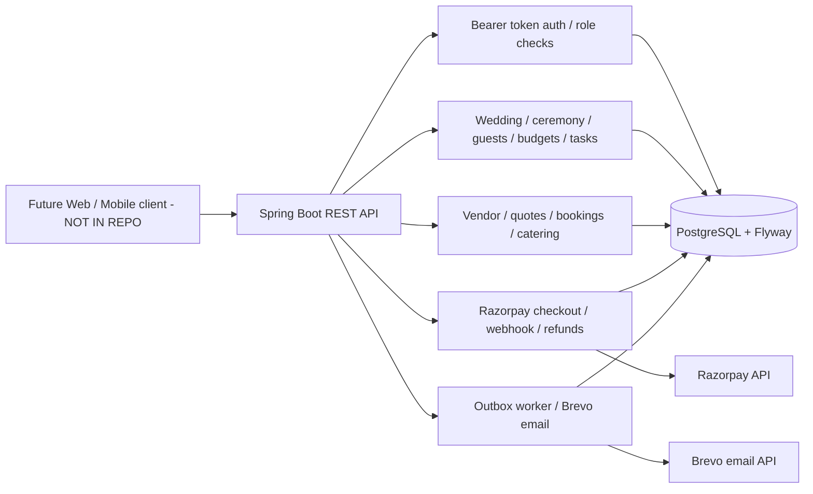
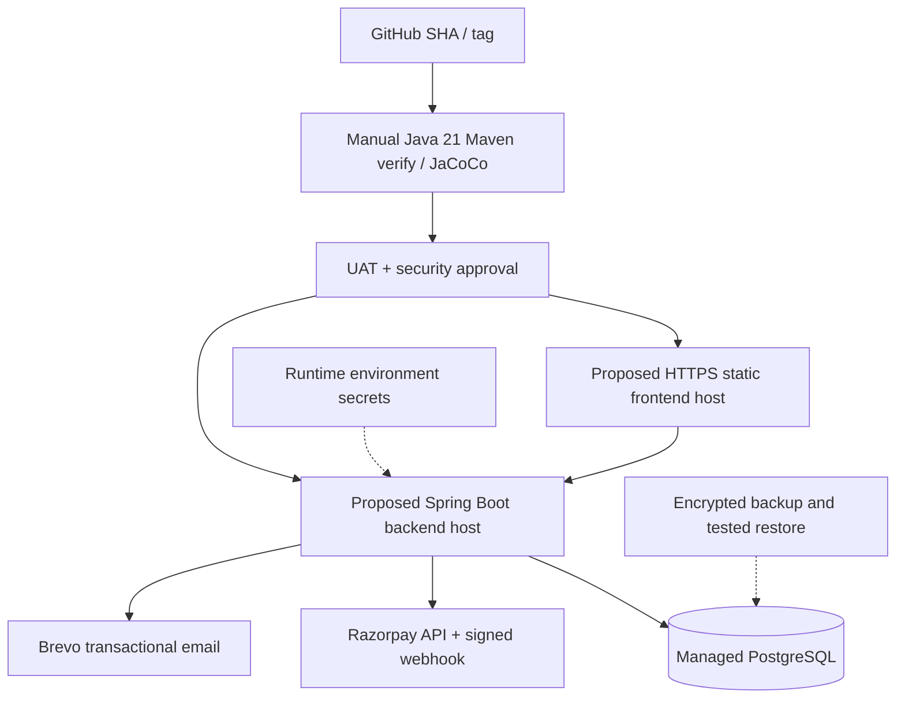
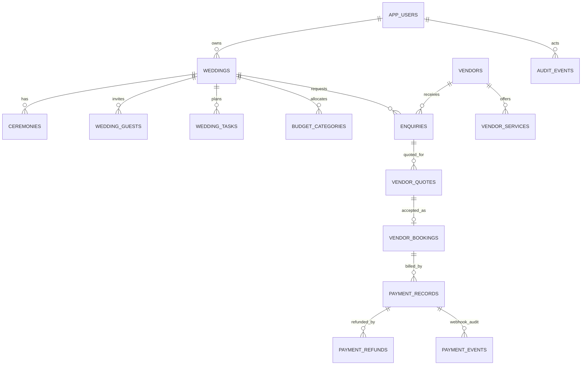

# WedFlow source audit, release plan and knowledge-transfer guide
**Date:** 2026-11-10. **Source:** bv-prasanna/wedplan main. **Status:** source review, not UAT certification.

## Findings and UI/UX scope
The current repository contains a Java/Spring Boot backend and no web/mobile application implementation. Therefore no claim is made that individual pages were visually reviewed. Frontend delivery is a release blocker. Proposed page inventory for implementation and visual UAT: landing/discovery; login/registration/password recovery; customer dashboard; wedding create/detail; ceremonies; guest list/RSVP; tasks; budget; vendor search/profile; enquiry/quotes; booking/calendar; catering; checkout/payment history/refunds; notifications; vendor onboarding/service catalogue/quotes/calendar; admin approvals/settlements/support/reports. For each page check mobile and desktop layouts, loading/empty/error/success, keyboard and screen reader, Kannada/English if specified by BRD, and unauthorized access.

## Verified source architecture

## Deployment reference — proposed, NOT deployed

## Core ER model — source-derived logical subset

For exact physical columns, constraints and relationships consult [schema index](SCHEMA_INDEX.md) and Flyway V1–V8. The live schema must be reconciled against a schema-only database export.

## API status, error, logging and security checklist
| Scenario | Expected contract |
|---|---|
| Bad input / invalid coordinates | 400, field-specific safe validation |
| Missing / invalid bearer token | 401, no sensitive token echo |
| Authenticated but wrong role | 403, deny server-side |
| Missing or non-owned wedding | 404 to avoid existence disclosure |
| Delete wedding with vendor/booking history | 409 conflict; no partial deletion |
| Stale booking / double allocation | 409, atomic reservation |
| Provider rejected payment | No fabricated success; provider response mapped safely |
| Payment captured | Success only after verified provider evidence |
| Refund requested | Pending, not “refunded”; webhook/reconciliation finalizes |
| Rate-limited auth | 429 with consistent retry policy |
| Unexpected exception | 500 safe message + correlation ID; redact stack/PII from clients |

Logs must include correlation ID, operation, duration, status and actor ID where appropriate. Do not log password, bearer tokens, Razorpay secrets, payment details or sensitive identity information. Review retention and access to geolocation/audit history.

## Prioritized security and functional backlog
**P0:** no frontend; payment/refund/settlement reconciliation and idempotency not certified; vendor payouts not completed; no live SMS; account recovery/verification and comprehensive RBAC incomplete; no successful Maven/PostgreSQL CI evidence. Confirm all financial data cannot be deleted through cascading wedding removal. Confirm audit service is wired to all important mutations, not just defined.
**P1:** quote versions and itemization; payment milestones; vendor portfolios/packages; collaborator and planner permissions; seating/dietary guest management; operational dashboards, reports and support cases; durable notification retry/recovery.
**P2:** accessibility, internationalization, visual consistency and mobile release once frontend exists.

## Runbook: migration, deployment and rollback
1. Record Git commit SHA, environment, DB identity and approver; do not place credentials in tickets.
2. Export schema-only and Flyway history; inspect pending migration V1–V8, checksum drift and failed migrations. Never edit an already-applied versioned SQL migration.
3. Take encrypted DB backup and **restore-test** in staging. Note RPO/RTO.
4. Run `mvn -B -f backend/pom.xml clean verify` with Java 21; archive Surefire XML and JaCoCo XML/HTML. Verify migration against disposable PostgreSQL before production.
5. Use [guarded script](migrate-safe.sh) in read-only plan mode first. Apply only with verified backup and explicit approval. Flyway validation checks migration names, types and checksums against applied history; do not run clean on production.
6. Deploy compatible backend release; configure datasource, Razorpay, webhook secret, CORS and email credentials through runtime secrets; health-check and smoke-test.
7. Verify negative paths, duplicate webhook/refund, booking concurrency, login/logout and data isolation. Monitor errors, payments, refunds and email queue.
8. Roll back application artifact to compatible SHA if safe; use forward-only schema fix or approved restore plan for database, never blindly reverse DDL.

## KT demo agenda and acceptance evidence
1. Architecture/roles/environments (10m)
2. Create wedding, ceremonies, guests, tasks and budget (15m)
3. Vendor approval, enquiry, quote, booking and date conflict (20m)
4. Razorpay test payment, failed payment, signed webhook replay, refund (20m)
5. Audit logs, geolocation unavailable/valid, notifications, errors and authorization (15m)
6. Flyway history, staging restore, runbook, CI and rollback (20m)

Record each demo with release SHA, environment, test IDs, pass/fail, screenshots/API responses, owner and defects. **Do not sign off** until P0 gaps are closed and test/coverage evidence is available.
