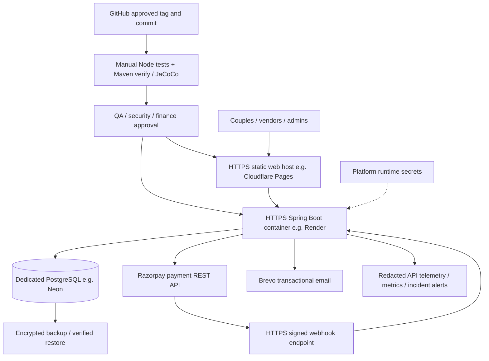

# WedFlow — deployment architecture, environments and release controls

**Reference topology only.** No production domain, hosting contract, billing status, secret configuration, uptime or live database was verified from the repository. This is a proposed deployment setup based on the actual Spring Boot/PostgreSQL + static JS frontend. Use Java 21 and a managed PostgreSQL instance with backups.

## Proposed low-cost dedicated deployment

Provider names are examples, **not verified active accounts or current free-tier guarantees**. A free-tier instance may sleep, lack backups or fall short of availability targets. Select a platform with SLA and recoverability matching customer contract.

## Environment separation

| Property | DEV | UAT | PROD |
|---|---|---|---|
| Static web origin | Local/isolated preview | Separate preview hostname | Verified customer domain + HTTPS |
| API | Local/isolated Java process | Separate staged Spring Boot service | Controlled, monitorable Java 21 deployment |
| PostgreSQL | Disposable development DB | Disposable/synthetic UAT DB | Dedicated production DB with backups |
| Payment gateway | Razorpay test keys | Test merchant + test callbacks | Approved live merchant + production webhook secret |
| Email | Test sender/stub | Verified test sender | Approved transactional sender and delivery monitoring |
| Auth and secrets | Non-production | Non-production isolated values | Distinct secrets, strict access controls |
| Logging | Local redacted | Request ID + UAT evidence | Central retention, alert owner, incident procedures |
| Migration | Flyway V1–V12 as required | Fresh schema, verified rollback test | Explicitly approved forward-only migration |

Do not copy customer guest lists or payment data into public test environments. Native Android delivery is **not** implemented in this repository.

## Application routing and runtime inputs

| Component | Required settings / source | Notes |
|---|---|---|
| Web | `web/config.js` → `window.WEDFLOW_API_BASE` | Public HTTPS API URL only; never place secrets there |
| Frontend CSP | `web/_headers` | Verify checkout iframe/script, font and API origins on actual host |
| Java backend | `backend/src/main/resources/application.properties` | Set `DATABASE_URL` (JDBC), `DATABASE_USERNAME`, `DATABASE_PASSWORD`; avoid dev fallback in prod |
| Cross-origin | `WEDFLOW_ALLOWED_ORIGINS` | Explicit production HTTPS web origins only |
| Razorpay | `RAZORPAY_KEY_ID`, `RAZORPAY_KEY_SECRET`, `RAZORPAY_WEBHOOK_SECRET` | Store only in secret manager; use different UAT/live sets |
| Email | `BREVO_API_KEY`, `NOTIFY_FROM_EMAIL` | Sender domain and limits must be verified |
| Background workers | `REFUND_POLL_MS`, `NOTIFY_POLL_MS` | Ensure scheduling is enabled and only planned instances perform work |
| Database pool | `DB_POOL_MAX` | Match provider max connections and app concurrency |
| Health | `/actuator/health` | Don't expose secrets or verbose DB config publicly |

## Deployment sequence (no hidden automatic migration)

1. Approve immutable Git SHA and UAT evidence. Review migration V1–V12 and current target Flyway history.
2. Create/verify an encrypted backup and successfully restore it to a disposable DB. Record its reference, RPO/RTO and owner.
3. On UAT, run the guarded [Flyway wrapper](migrate-safe.sh) in `plan`, `info`, `validate`, then approved `migrate` mode. The runtime has startup Flyway enabled; prevent a second migrator from racing with service startup.
4. Build Java 21 backend with `mvn -B -f backend/pom.xml clean verify`; inspect test output and JaCoCo. Run `cd web && npm run verify`.
5. Configure secrets, TLS/DNS and precise CORS; deploy API then web, making sure `web/config.js` routes to the correct **same-environment** API.
6. Smoke-test registration/login, owned data, vendor approval/search, bookings/availability, checkout, signed captured/failed callback, cancellation/refund queue, notification delivery and admin audit.
7. Observe latency, 4xx/5xx spikes, reconciliation queues, provider callbacks and backup jobs. Release only after signoff and recovery drill.

**Never** pass arbitrary commands as migration arguments, run `flyway clean` on customer data, or edit already-applied versioned migrations. If rollback needs a schema change, prefer a reviewed forward-fix or tested restore plan. Downgrading an app while keeping later schema versions can be unsafe.

## Source-controlled manual verification

[Manual full-stack GitHub Actions](../../.github/workflows/manual-backend-verify.yml) runs frontend checks and Maven/PostgreSQL tests **only when dispatched**. A committed workflow is not proof of a successful run. Record Git SHA, run URL, artifacts, coverage, target database schema version and operator before deployment.

## Operations and data recovery

- Daily: uptime, auth abuse, 5xx, failed callbacks, payment/booking mismatch, refund `REQUIRES_RECONCILIATION`, email `FAILED`.
- Weekly: inspect Flyway history, take/review backups, restore sample, audit least-privilege roles, check sender and webhook retries.
- Monthly: vulnerability/dependency updates, credential rotation, incident simulation, data-retention review and financial reconciliation.
- Emergency: stop checkout writes if financial correctness is at risk, preserve request references and provider evidence, disable compromised credentials, perform approved forward-fix/restore and record RCA.

See [maintenance and KT playbook](DEPLOYMENT_MAINTENANCE_KT.md) and [UAT cases](../SCREEN-BY-SCREEN-UAT-2026-11-10.md).
