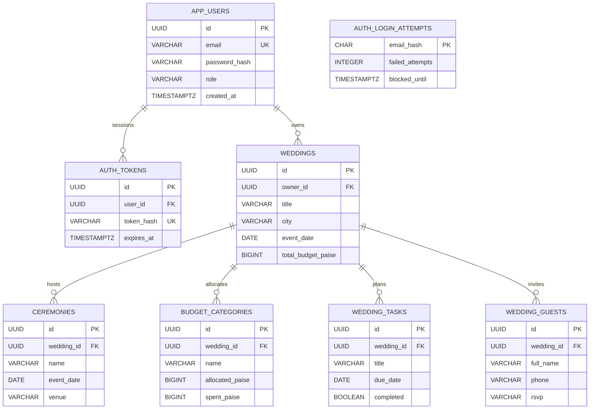
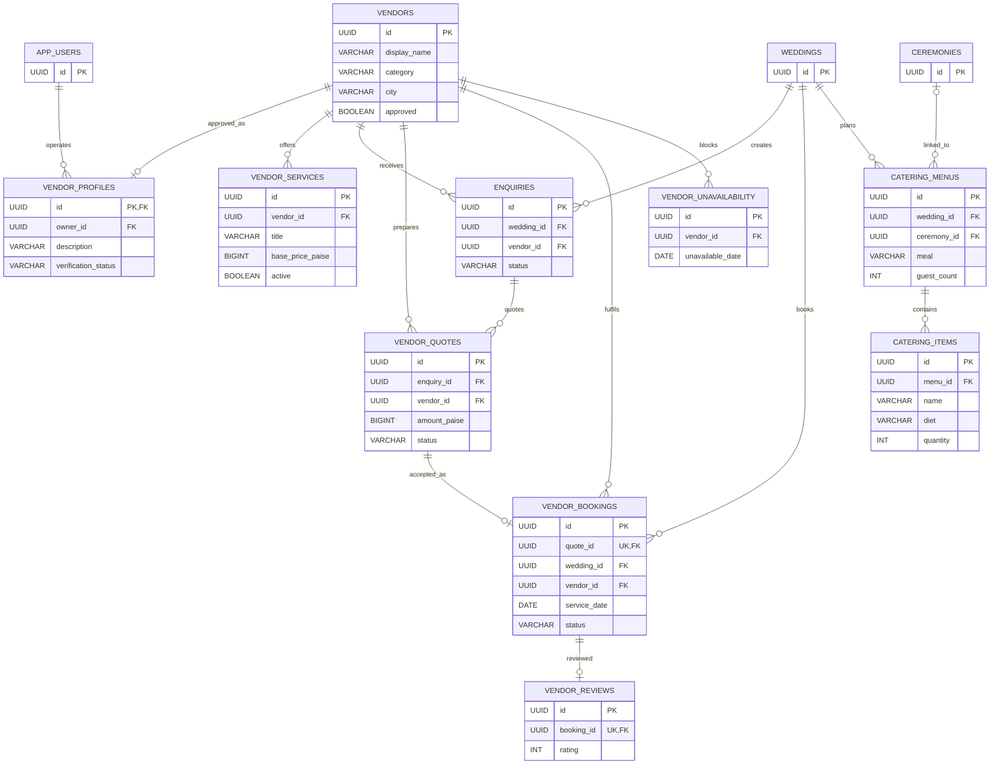
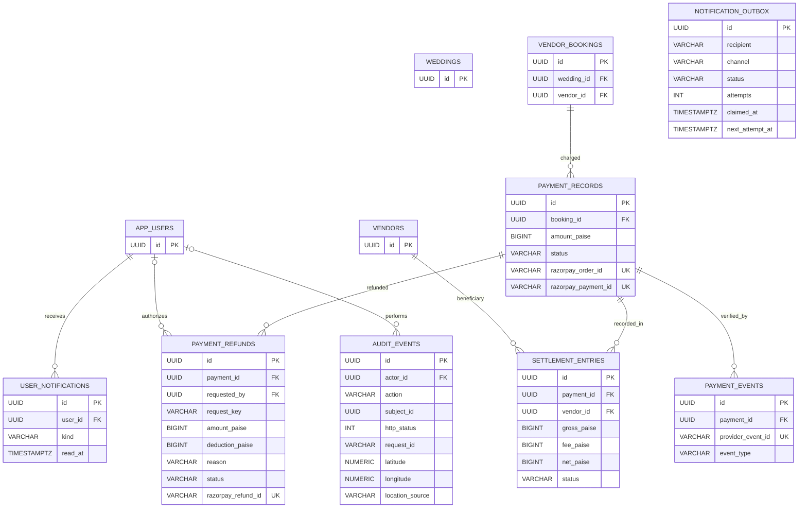

# WedFlow — full logical ER diagrams, schema and data ownership

**Verified against repository SQL V1–V12, not against a deployed physical database.** The diagrams represent declared references and important columns, not every implicit business invariant. All financial amounts are integer paise. Review `flyway_schema_history` and `pg_dump --schema-only` to establish production physical schema.

## Identity and wedding planning

**Important:** `AUTH_LOGIN_ATTEMPTS.email_hash` is an independently hashed identifier and **not a declared FK** to `APP_USERS`. Wedding guest phone numbers are personally identifiable and must remain owner-scoped. Wedding deletion must reject vendor history; the original cascade on planning tables must never be used to erase financial records.

## Vendor, service, catering and booking domain

**Booking invariant:** PostgreSQL partial unique index `ux_active_vendor_day` covers one `CONFIRMED` booking for a vendor/service date (not all statuses). Accepting a quote requires source-level locks and vendor availability checks. `catering_menus` has a `UNIQUE(wedding_id,ceremony_id,meal)` constraint, but PostgreSQL uniqueness of nullable ceremony_id needs separate handling; the controller also serializes and rejects duplicate null-ceremony menus.

## Finance, notifications and auditing

**Declared versus implied relationships:** `notification_outbox.recipient` is a string, not an FK to `app_users`. `audit_events.subject_id` is polymorphic, not an FK. `payment_refunds.request_key` has a partial **composite unique index on (payment_id,request_key)**. `settlement_entries` does **not** make live transfers to vendors; it is not a certified payout ledger.

## Schema integrity and security rules

- Keep bearer tokens as SHA-256 hashes in `auth_tokens`; only the browser receives a raw bearer token. Enforce 401 for missing/expired tokens and 403 for wrong-role operations.
- Keep money in integer paise; enforce overpayment, over-refund and concurrent booking controls at the database transaction layer.
- Use **admin-only** refund creation, a cancelled booking, a mandatory reason and an idempotency key; `QUEUED` and `PROCESSING` are not financially completed states.
- Provider-signed refund callbacks validate provider payment ID, amount and INR currency. Unknown provider outcomes need explicit reconciliation without blind replay.
- Keep email delivery status independent of payment confirmation. V12 enables at-least-once delivery but cannot guarantee exactly once.
- Store optional event location only with user consent and a declared unavailable reason; never treat client GPS as authoritative identity or attendance proof.
- Restrict DB exports, user guest data and audit geo records; document retention, encryption, backups and account deletion policy.

## Source of truth

`backend/src/main/resources/db/migration/V1__initial.sql` through `V12__notification_delivery_recovery.sql`, supplemented by actual target Flyway checksums and read-only `pg_dump --schema-only`. For an operator-checked schema export use [guarded migration tool](migrate-safe.sh) in `export-schema` mode. No migration has been applied by this documentation update.
