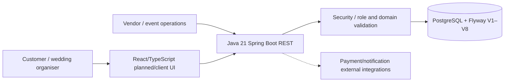

# WedPlan / WedFlow — code-derived architecture and KT map

> Inspected [`bv-prasanna/wedplan` `main`](https://github.com/bv-prasanna/wedplan/tree/main) 10 November 2026. A repository code inventory does **not** establish deployment, passing CI or completed UAT.

## Architecture

The backend code is in `backend/src/main/java`; the README describes frontend React/TypeScript, but the inspected main tree is backend-focused. A separately deployed frontend/hosting setup **is not established** by this source. UI component is logical, not a verified deployment.

## Java REST controller entry points — 15
- [`backend/src/main/java/com/wedflow/api/AccountController.java`](https://github.com/bv-prasanna/wedplan/blob/main/backend/src/main/java/com/wedflow/api/AccountController.java)
- [`backend/src/main/java/com/wedflow/api/AdminController.java`](https://github.com/bv-prasanna/wedplan/blob/main/backend/src/main/java/com/wedflow/api/AdminController.java)
- [`backend/src/main/java/com/wedflow/api/AuthController.java`](https://github.com/bv-prasanna/wedplan/blob/main/backend/src/main/java/com/wedflow/api/AuthController.java)
- [`backend/src/main/java/com/wedflow/api/CateringController.java`](https://github.com/bv-prasanna/wedplan/blob/main/backend/src/main/java/com/wedflow/api/CateringController.java)
- [`backend/src/main/java/com/wedflow/api/CommerceController.java`](https://github.com/bv-prasanna/wedplan/blob/main/backend/src/main/java/com/wedflow/api/CommerceController.java)
- [`backend/src/main/java/com/wedflow/api/OperationsController.java`](https://github.com/bv-prasanna/wedplan/blob/main/backend/src/main/java/com/wedflow/api/OperationsController.java)
- [`backend/src/main/java/com/wedflow/api/PaymentsController.java`](https://github.com/bv-prasanna/wedplan/blob/main/backend/src/main/java/com/wedflow/api/PaymentsController.java)
- [`backend/src/main/java/com/wedflow/api/PlanningController.java`](https://github.com/bv-prasanna/wedplan/blob/main/backend/src/main/java/com/wedflow/api/PlanningController.java)
- [`backend/src/main/java/com/wedflow/api/VendorController.java`](https://github.com/bv-prasanna/wedplan/blob/main/backend/src/main/java/com/wedflow/api/VendorController.java)
- [`backend/src/main/java/com/wedflow/api/VendorWorkspaceController.java`](https://github.com/bv-prasanna/wedplan/blob/main/backend/src/main/java/com/wedflow/api/VendorWorkspaceController.java)
- [`backend/src/main/java/com/wedflow/api/WeddingController.java`](https://github.com/bv-prasanna/wedplan/blob/main/backend/src/main/java/com/wedflow/api/WeddingController.java)
- [`backend/src/main/java/com/wedflow/notification/NotificationOutboxController.java`](https://github.com/bv-prasanna/wedplan/blob/main/backend/src/main/java/com/wedflow/notification/NotificationOutboxController.java)
- [`backend/src/main/java/com/wedflow/payment/RazorpayCheckoutController.java`](https://github.com/bv-prasanna/wedplan/blob/main/backend/src/main/java/com/wedflow/payment/RazorpayCheckoutController.java)
- [`backend/src/main/java/com/wedflow/payment/RazorpayWebhookController.java`](https://github.com/bv-prasanna/wedplan/blob/main/backend/src/main/java/com/wedflow/payment/RazorpayWebhookController.java)
- [`backend/src/main/java/com/wedflow/payment/RefundController.java`](https://github.com/bv-prasanna/wedplan/blob/main/backend/src/main/java/com/wedflow/payment/RefundController.java)

## Service implementation classes — 2
- [`backend/src/main/java/com/wedflow/audit/AuditEventService.java`](https://github.com/bv-prasanna/wedplan/blob/main/backend/src/main/java/com/wedflow/audit/AuditEventService.java)
- [`backend/src/main/java/com/wedflow/security/LoginAttemptService.java`](https://github.com/bv-prasanna/wedplan/blob/main/backend/src/main/java/com/wedflow/security/LoginAttemptService.java)

## Database migrations — 10
- [`backend/src/main/resources/db/migration/V10__audit_http_context.sql`](https://github.com/bv-prasanna/wedplan/blob/main/backend/src/main/resources/db/migration/V10__audit_http_context.sql)
- [`backend/src/main/resources/db/migration/V1__initial.sql`](https://github.com/bv-prasanna/wedplan/blob/main/backend/src/main/resources/db/migration/V1__initial.sql)
- [`backend/src/main/resources/db/migration/V2__auth_tokens.sql`](https://github.com/bv-prasanna/wedplan/blob/main/backend/src/main/resources/db/migration/V2__auth_tokens.sql)
- [`backend/src/main/resources/db/migration/V3__planning.sql`](https://github.com/bv-prasanna/wedplan/blob/main/backend/src/main/resources/db/migration/V3__planning.sql)
- [`backend/src/main/resources/db/migration/V4__commerce.sql`](https://github.com/bv-prasanna/wedplan/blob/main/backend/src/main/resources/db/migration/V4__commerce.sql)
- [`backend/src/main/resources/db/migration/V5__operations.sql`](https://github.com/bv-prasanna/wedplan/blob/main/backend/src/main/resources/db/migration/V5__operations.sql)
- [`backend/src/main/resources/db/migration/V6__constraints.sql`](https://github.com/bv-prasanna/wedplan/blob/main/backend/src/main/resources/db/migration/V6__constraints.sql)
- [`backend/src/main/resources/db/migration/V7__razorpay.sql`](https://github.com/bv-prasanna/wedplan/blob/main/backend/src/main/resources/db/migration/V7__razorpay.sql)
- [`backend/src/main/resources/db/migration/V8__event_geolocation.sql`](https://github.com/bv-prasanna/wedplan/blob/main/backend/src/main/resources/db/migration/V8__event_geolocation.sql)
- [`backend/src/main/resources/db/migration/V9__login_abuse_protection.sql`](https://github.com/bv-prasanna/wedplan/blob/main/backend/src/main/resources/db/migration/V9__login_abuse_protection.sql)

Data model is derived from Flyway tables/columns, planning, commerce, operations, auth tokens, Razorpay integration and event geolocation. See [full source-derived schema/ER](SCHEMA_INDEX.md). **Do not infer deployed data state or physical FK definitions without `pg_dump --schema-only` and `flyway_schema_history`.**

## Build and CI
- [Maven POM](../../backend/pom.xml): Java 21/Spring Boot, PostgreSQL, Flyway, tests and JaCoCo configuration. Use `mvn -f backend/pom.xml verify` in a compatible JDK 21 environment, then inspect actual result.
- CI: [`.github/workflows/manual-backend-verify.yml`](https://github.com/bv-prasanna/wedplan/blob/main/.github/workflows/manual-backend-verify.yml)
- Test source files identified: **13**, not an assertion of test coverage.
- [Safe DB plan and migration workflow](migrate-safe.sh) defaults to read-only status. Never apply migrations without backup + tested restore + approval.

## KT and UAT
Demonstrate wedding/event creation, vendor management, quote/booking lifecycle, status transitions, Razorpay sandbox verification/refunds, event location capture, admin authorization and audit. Include duplicate event idempotency, wrong roles, invalid data, partial failure, privacy and gateway downtime. Verify schema migrations on dedicated UAT DB, service logging, deployment origins, backups, rollback and on-call owners.

## Unverified deployment gates
No confirmed frontend production artifact, live service registry, exact deployed SHA, physical database schema export, actual secret-store config, backup restoration, coverage evidence, completed mobile/web UAT or signed customer acceptance was observed during repository-source review. Reconcile these before a production handover.

Related: [architecture/deployment/KT](README.md) · [schema/ER](SCHEMA_INDEX.md).