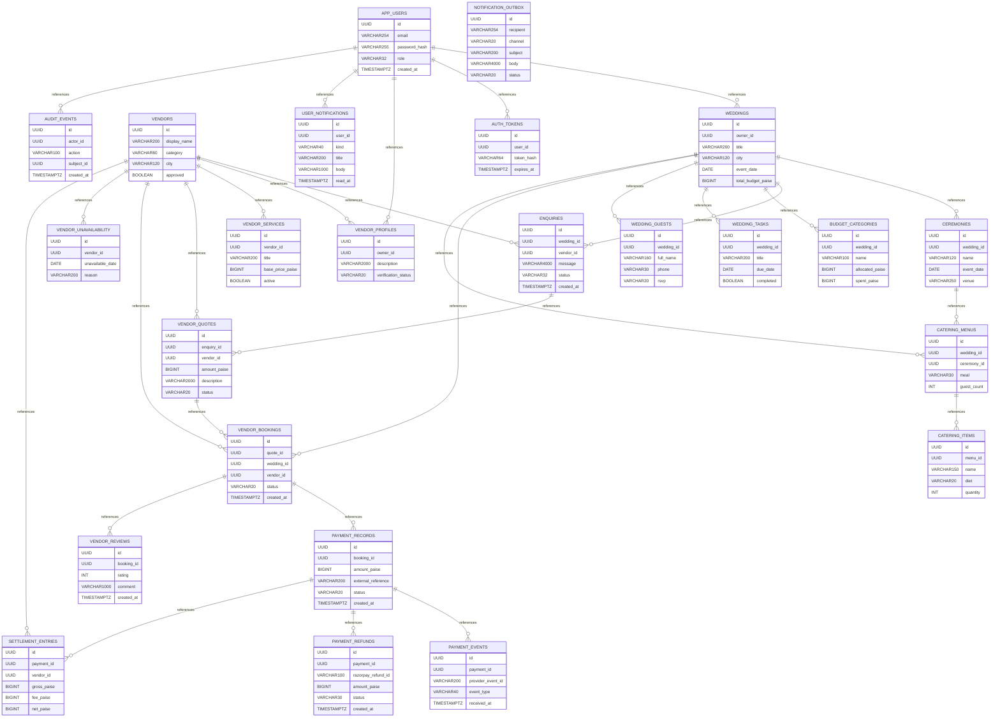

# WedPlan/WedFlow - SQL and ER Catalog

> All **8** Flyway SQL migration files on current `main` were inspected on 2026-11-09. **Source-derived**, not verified live PostgreSQL physical schema.

## Migration source links
- [`V1__initial.sql`](../../backend/src/main/resources/db/migration/V1__initial.sql)
- [`V2__auth_tokens.sql`](../../backend/src/main/resources/db/migration/V2__auth_tokens.sql)
- [`V3__planning.sql`](../../backend/src/main/resources/db/migration/V3__planning.sql)
- [`V4__commerce.sql`](../../backend/src/main/resources/db/migration/V4__commerce.sql)
- [`V5__operations.sql`](../../backend/src/main/resources/db/migration/V5__operations.sql)
- [`V6__constraints.sql`](../../backend/src/main/resources/db/migration/V6__constraints.sql)
- [`V7__razorpay.sql`](../../backend/src/main/resources/db/migration/V7__razorpay.sql)
- [`V8__event_geolocation.sql`](../../backend/src/main/resources/db/migration/V8__event_geolocation.sql)

## ER model — newly created tables and explicit references

## Table and column dictionary
### `app_users`
Introduced by [`V1__initial.sql`](../../backend/src/main/resources/db/migration/V1__initial.sql)

| Column | Declared type |
|---|---|
| `id` | `UUID` |
| `email` | `VARCHAR(254)` |
| `password_hash` | `VARCHAR(255)` |
| `role` | `VARCHAR(32)` |
| `created_at` | `TIMESTAMPTZ` |

### `weddings`
Introduced by [`V1__initial.sql`](../../backend/src/main/resources/db/migration/V1__initial.sql)

| Column | Declared type |
|---|---|
| `id` | `UUID` |
| `owner_id` | `UUID` |
| `title` | `VARCHAR(200)` |
| `city` | `VARCHAR(120)` |
| `event_date` | `DATE` |
| `total_budget_paise` | `BIGINT` |
| `created_at` | `TIMESTAMPTZ` |

### `ceremonies`
Introduced by [`V1__initial.sql`](../../backend/src/main/resources/db/migration/V1__initial.sql)

| Column | Declared type |
|---|---|
| `id` | `UUID` |
| `wedding_id` | `UUID` |
| `name` | `VARCHAR(120)` |
| `event_date` | `DATE` |
| `venue` | `VARCHAR(250)` |

### `vendors`
Introduced by [`V1__initial.sql`](../../backend/src/main/resources/db/migration/V1__initial.sql)

| Column | Declared type |
|---|---|
| `id` | `UUID` |
| `display_name` | `VARCHAR(200)` |
| `category` | `VARCHAR(80)` |
| `city` | `VARCHAR(120)` |
| `approved` | `BOOLEAN` |

### `enquiries`
Introduced by [`V1__initial.sql`](../../backend/src/main/resources/db/migration/V1__initial.sql)

| Column | Declared type |
|---|---|
| `id` | `UUID` |
| `wedding_id` | `UUID` |
| `vendor_id` | `UUID` |
| `message` | `VARCHAR(4000)` |
| `status` | `VARCHAR(32)` |
| `created_at` | `TIMESTAMPTZ` |

### `auth_tokens`
Introduced by [`V2__auth_tokens.sql`](../../backend/src/main/resources/db/migration/V2__auth_tokens.sql)

| Column | Declared type |
|---|---|
| `id` | `UUID` |
| `user_id` | `UUID` |
| `token_hash` | `VARCHAR(64)` |
| `expires_at` | `TIMESTAMPTZ` |

### `budget_categories`
Introduced by [`V3__planning.sql`](../../backend/src/main/resources/db/migration/V3__planning.sql)

| Column | Declared type |
|---|---|
| `id` | `UUID` |
| `wedding_id` | `UUID` |
| `name` | `VARCHAR(100)` |
| `allocated_paise` | `BIGINT` |
| `spent_paise` | `BIGINT` |

### `wedding_tasks`
Introduced by [`V3__planning.sql`](../../backend/src/main/resources/db/migration/V3__planning.sql)

| Column | Declared type |
|---|---|
| `id` | `UUID` |
| `wedding_id` | `UUID` |
| `title` | `VARCHAR(200)` |
| `due_date` | `DATE` |
| `completed` | `BOOLEAN` |

### `wedding_guests`
Introduced by [`V3__planning.sql`](../../backend/src/main/resources/db/migration/V3__planning.sql)

| Column | Declared type |
|---|---|
| `id` | `UUID` |
| `wedding_id` | `UUID` |
| `full_name` | `VARCHAR(160)` |
| `phone` | `VARCHAR(30)` |
| `rsvp` | `VARCHAR(20)` |

### `vendor_profiles`
Introduced by [`V4__commerce.sql`](../../backend/src/main/resources/db/migration/V4__commerce.sql)

| Column | Declared type |
|---|---|
| `id` | `UUID` |
| `owner_id` | `UUID` |
| `description` | `VARCHAR(2000)` |
| `verification_status` | `VARCHAR(20)` |

### `vendor_services`
Introduced by [`V4__commerce.sql`](../../backend/src/main/resources/db/migration/V4__commerce.sql)

| Column | Declared type |
|---|---|
| `id` | `UUID` |
| `vendor_id` | `UUID` |
| `title` | `VARCHAR(200)` |
| `base_price_paise` | `BIGINT` |
| `active` | `BOOLEAN` |

### `vendor_quotes`
Introduced by [`V4__commerce.sql`](../../backend/src/main/resources/db/migration/V4__commerce.sql)

| Column | Declared type |
|---|---|
| `id` | `UUID` |
| `enquiry_id` | `UUID` |
| `vendor_id` | `UUID` |
| `amount_paise` | `BIGINT` |
| `description` | `VARCHAR(2000)` |
| `status` | `VARCHAR(20)` |
| `created_at` | `TIMESTAMPTZ` |

### `vendor_bookings`
Introduced by [`V4__commerce.sql`](../../backend/src/main/resources/db/migration/V4__commerce.sql)

| Column | Declared type |
|---|---|
| `id` | `UUID` |
| `quote_id` | `UUID` |
| `wedding_id` | `UUID` |
| `vendor_id` | `UUID` |
| `status` | `VARCHAR(20)` |
| `created_at` | `TIMESTAMPTZ` |

### `catering_menus`
Introduced by [`V4__commerce.sql`](../../backend/src/main/resources/db/migration/V4__commerce.sql)

| Column | Declared type |
|---|---|
| `id` | `UUID` |
| `wedding_id` | `UUID` |
| `ceremony_id` | `UUID` |
| `meal` | `VARCHAR(30)` |
| `guest_count` | `INT` |

### `catering_items`
Introduced by [`V4__commerce.sql`](../../backend/src/main/resources/db/migration/V4__commerce.sql)

| Column | Declared type |
|---|---|
| `id` | `UUID` |
| `menu_id` | `UUID` |
| `name` | `VARCHAR(150)` |
| `diet` | `VARCHAR(20)` |
| `quantity` | `INT` |

### `payment_records`
Introduced by [`V4__commerce.sql`](../../backend/src/main/resources/db/migration/V4__commerce.sql)

| Column | Declared type |
|---|---|
| `id` | `UUID` |
| `booking_id` | `UUID` |
| `amount_paise` | `BIGINT` |
| `external_reference` | `VARCHAR(200)` |
| `status` | `VARCHAR(20)` |
| `created_at` | `TIMESTAMPTZ` |

### `vendor_unavailability`
Introduced by [`V5__operations.sql`](../../backend/src/main/resources/db/migration/V5__operations.sql)

| Column | Declared type |
|---|---|
| `id` | `UUID` |
| `vendor_id` | `UUID` |
| `unavailable_date` | `DATE` |
| `reason` | `VARCHAR(200)` |

### `vendor_reviews`
Introduced by [`V5__operations.sql`](../../backend/src/main/resources/db/migration/V5__operations.sql)

| Column | Declared type |
|---|---|
| `id` | `UUID` |
| `booking_id` | `UUID` |
| `rating` | `INT` |
| `comment` | `VARCHAR(1000)` |
| `created_at` | `TIMESTAMPTZ` |

### `user_notifications`
Introduced by [`V5__operations.sql`](../../backend/src/main/resources/db/migration/V5__operations.sql)

| Column | Declared type |
|---|---|
| `id` | `UUID` |
| `user_id` | `UUID` |
| `kind` | `VARCHAR(40)` |
| `title` | `VARCHAR(200)` |
| `body` | `VARCHAR(1000)` |
| `read_at` | `TIMESTAMPTZ` |
| `created_at` | `TIMESTAMPTZ` |

### `payment_events`
Introduced by [`V5__operations.sql`](../../backend/src/main/resources/db/migration/V5__operations.sql)

| Column | Declared type |
|---|---|
| `id` | `UUID` |
| `payment_id` | `UUID` |
| `provider_event_id` | `VARCHAR(200)` |
| `event_type` | `VARCHAR(40)` |
| `received_at` | `TIMESTAMPTZ` |

### `audit_events`
Introduced by [`V5__operations.sql`](../../backend/src/main/resources/db/migration/V5__operations.sql)

| Column | Declared type |
|---|---|
| `id` | `UUID` |
| `actor_id` | `UUID` |
| `action` | `VARCHAR(100)` |
| `subject_id` | `UUID` |
| `created_at` | `TIMESTAMPTZ` |

### `payment_refunds`
Introduced by [`V7__razorpay.sql`](../../backend/src/main/resources/db/migration/V7__razorpay.sql)

| Column | Declared type |
|---|---|
| `id` | `UUID` |
| `payment_id` | `UUID` |
| `razorpay_refund_id` | `VARCHAR(100)` |
| `amount_paise` | `BIGINT` |
| `status` | `VARCHAR(30)` |
| `created_at` | `TIMESTAMPTZ` |

### `settlement_entries`
Introduced by [`V7__razorpay.sql`](../../backend/src/main/resources/db/migration/V7__razorpay.sql)

| Column | Declared type |
|---|---|
| `id` | `UUID` |
| `payment_id` | `UUID` |
| `vendor_id` | `UUID` |
| `gross_paise` | `BIGINT` |
| `fee_paise` | `BIGINT` |
| `net_paise` | `BIGINT` |
| `status` | `VARCHAR(30)` |
| `created_at` | `TIMESTAMPTZ` |

### `notification_outbox`
Introduced by [`V7__razorpay.sql`](../../backend/src/main/resources/db/migration/V7__razorpay.sql)

| Column | Declared type |
|---|---|
| `id` | `UUID` |
| `recipient` | `VARCHAR(254)` |
| `channel` | `VARCHAR(20)` |
| `subject` | `VARCHAR(200)` |
| `body` | `VARCHAR(4000)` |
| `status` | `VARCHAR(20)` |
| `attempts` | `INT` |
| `created_at` | `TIMESTAMPTZ` |
| `sent_at` | `TIMESTAMPTZ` |

## Added columns in later migrations
| Table | Column | Type | Migration |
|---|---|---|---|
| `vendor_bookings` | `service_date` | `DATE` | [SQL](../../backend/src/main/resources/db/migration/V5__operations.sql) |
| `vendor_bookings` | `cancelled_at` | `TIMESTAMPTZ` | [SQL](../../backend/src/main/resources/db/migration/V5__operations.sql) |
| `payment_records` | `razorpay_order_id` | `VARCHAR` | [SQL](../../backend/src/main/resources/db/migration/V7__razorpay.sql) |
| `payment_records` | `razorpay_payment_id` | `VARCHAR` | [SQL](../../backend/src/main/resources/db/migration/V7__razorpay.sql) |
| `audit_events` | `latitude` | `NUMERIC` | [SQL](../../backend/src/main/resources/db/migration/V8__event_geolocation.sql) |
| `audit_events` | `longitude` | `NUMERIC` | [SQL](../../backend/src/main/resources/db/migration/V8__event_geolocation.sql) |
| `audit_events` | `location_source` | `VARCHAR` | [SQL](../../backend/src/main/resources/db/migration/V8__event_geolocation.sql) |
| `audit_events` | `location_accuracy_m` | `NUMERIC` | [SQL](../../backend/src/main/resources/db/migration/V8__event_geolocation.sql) |
| `audit_events` | `location_recorded_at` | `TIMESTAMPTZ` | [SQL](../../backend/src/main/resources/db/migration/V8__event_geolocation.sql) |
| `audit_events` | `location_unavailable_reason` | `VARCHAR` | [SQL](../../backend/src/main/resources/db/migration/V8__event_geolocation.sql) |

## Deployment verification and KT
- Test wedding planning, vendor quotes, order and cancellation flows, Razorpay **sandbox** callbacks, user permissions and event geolocation retention/consent.
- Before applying migrations: exact DB instance, Flyway history, checksum, backup/restore, staging tests, approved version/release and post-migrate smoke.
- Reconcile with `pg_dump --schema-only` for final FK, indexes, views, triggers and all ALTER/DROP changes. This parser is conservative and not equivalent to live introspection.
- Handover: [architecture/deployment/UAT and maintenance](README.md) · [guarded migration operator script](migrate-safe.sh).
