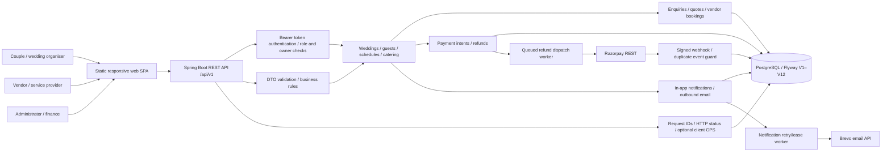

# WedFlow — system architecture and event lifecycles

**Source reviewed:** `bv-prasanna/wedplan` on 10 November 2026. These diagrams describe the code in `backend/`, `web/` and Flyway migrations **V1–V12**; they are not confirmation of deployed infrastructure, passing CI or complete SRS coverage.

## Application architecture



The backend uses Java 21, Spring Boot, JDBC and Flyway; the frontend is dependency-free JavaScript/CSS/HTML under `web/`. The web uses short-lived client geolocation consent with `X-Geo-*` mutation headers, captured only when available. These are **self-reported** coordinates and are not independent proof of physical presence. There is **no native mobile application** in this repository.

## Customer, vendor and admin journeys

```mermaid
sequenceDiagram
  autonumber
  actor Customer
  participant Web as WedFlow web
  participant API as Spring API
  participant DB as PostgreSQL
  actor Vendor
  actor Admin
  Customer->>Web: Sign in and create wedding
  Web->>API: Authenticated wedding request
  API->>DB: Enforce wedding owner and save
  Customer->>Web: Send approved vendor enquiry
  Web->>API: POST /weddings/{id}/enquiries
  API->>DB: Check vendor approved; persist
  Vendor->>API: Send quote
  API->>DB: Check vendor owner and approval
  Customer->>API: Accept quote for service date
  API->>DB: Lock quote/vendor and reserve unique date
  Customer->>API: Create payment intent
  API->>DB: Lock booking; reserve unpaid balance
  Customer->>API: Request Razorpay checkout order
  API->>Razorpay: Create/reuse payment order
  Note over API,Razorpay: Order creation still requires provider failure/idempotency UAT
  Razorpay-->>API: HMAC-signed payment webhook
  API->>DB: Verify event, amount, currency and mark VERIFIED
  Customer->>API: Cancel confirmed booking
  API->>DB: Mark CANCELLED
  Admin->>API: Review cancellation, fee and refund amount
  API->>DB: Create idempotent QUEUED refund request
  API-->>Admin: 202 Accepted (not processed)
  Note over API,DB: Worker claims QUEUED after commit, submits once
  API->>Razorpay: Submit provider refund
  Razorpay-->>API: Signed refund processed/failed
  API->>DB: Reconcile provider callback and local refund status
```

**State semantics:** `PENDING` or `QUEUED` does not mean money was captured, transferred or returned. `VERIFIED` payment means the server accepted a validated captured webhook; a refund is `PROCESSED` only after a verified provider callback. Unknown refund outcomes become `REQUIRES_RECONCILIATION`; never auto-resubmit without a provider audit.

## Ownership and access boundaries

| Boundary | Source behavior | Known limitation |
|---|---|---|
| Authentication | Random 256-bit bearer token, stored hashed; bcrypt password; token revocation | Registration lacks verified-email and password-recovery flow |
| Wedding scope | Owner ID checked for ceremonies, guests, tasks, budgets, enquiries, payments | No planner/collaborator grant model yet |
| Vendor scope | Vendor owner queries; quote sending requires approval | No staff delegation or vendor portfolios |
| Admin | Role check on approvals, summaries and refund queues | Secure admin-account provisioning/bootstrap still required |
| Payment | Wedding owner can create intent/checkout; refunds require admin role and cancelled booking | Payment provider order creation/reconciliation needs further isolation and testing |
| Audit | Request/HTTP status IDs plus optional client GPS; no body logging | Audit persistence is best-effort; strong tamper-evidence/retention requires operations |
| Messaging | In-app inbox, Brevo email with retry worker | SMS, templates, delivery webhooks and duplicate-email minimization incomplete |

## Runtime patterns and maintenance concerns

- **Booking date uniqueness:** `ux_active_vendor_day` permits one confirmed booking per vendor/day. Quote acceptance serializes on database rows; test concurrency with real PostgreSQL.
- **Payments:** `payment_events.provider_event_id` deduplicates signed callbacks; checkout order creation calls the provider while holding a DB transaction and still requires a robust provider order reconciliation path.
- **Refunds:** V11 tracks request key, admin reason/deduction and provider dispatch. PROCESSING state is never automatically retried; an operator must verify the gateway outcome before manual action.
- **Outbox:** V12 adds claim times, retry times and stale lease recovery. Email delivery is at-least-once; process failure after gateway acceptance may resend the same email.
- **Logging:** requestId and API status are returned in problem responses; logs must avoid passwords, bearer tokens, raw payment or PII and client geo unless in access-controlled audit data.
- **Costs/hosting:** cloud service tiers, availability, quotas, mail/SMS fees and gateway charges must be verified before choosing production hosting.

## Next references

[Deployment topology](DEPLOYMENT_TOPOLOGIES.md) · [Full logical ER](ER_FULL_DOMAIN.md) · [SQL and migration catalogue](SCHEMA_INDEX.md) · [Operations and demo handover](DEPLOYMENT_MAINTENANCE_KT.md) · [UAT checklist](../SCREEN-BY-SCREEN-UAT-2026-11-10.md).
